# Beautiful Weather for AWTRIX NG (Ulanzi TC002)

**Version 2.8** · by Hank_the_Tank / Claude · for the **52×16 panel** of the Ulanzi TC002

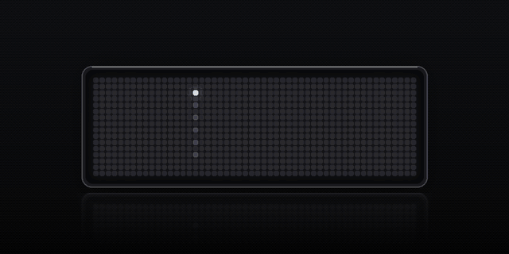

**Install from the AWTRIX Hub:** [https://awtrix.de/script/O3xYAw5TPWWp](https://awtrix.de/script/O3xYAw5TPWWp)

Current weather with big animated 16×16 symbols, and five more pages you open by turning the knob – or that change by themselves: rain in the next three hours, wind with a wind rose, a 3-day forecast, sunrise and sunset, and the moon phase with moonrise and moonset. The weather data comes from [Open-Meteo](https://open-meteo.com), so you don't need an API key or an account.

```
 turn the knob →
┌──────────┬────────────────────────────┐
│ weather  │ 12°  81%                   │  1 Weather   (start page)
│ symbol   │ ▁▂▃▄▅▅▆▇▇▆▅▄▃▂▁            │
├──────────┼────────────────────────────┤
│ umbrella │ IN 10 MIN                  │  2 Rain      (next 3 hours)
│          │ ▁ ▃ ▁   ▅ ▂                │
├──────────┼────────────────────────────┤
│ wind     │ 18  SW    ⇄  32  GUST      │  3 Wind      (wind and gusts take turns)
│ rose     │ ▂▃▃▅▅▆▅▃▃▂▂▁  (next 12 h)  │
├──────────┼────────────────────────────┤
│ symbol   │ MON              40%       │  4 Forecast  (3 days, 3.5 s each)
│ of day   │ 15°   7°                   │
├──────────┼────────────────────────────┤
│ sun on   │ ↑ 07:45                    │  5 Sun
│ horizon  │ ↓ 18:42                    │
├──────────┼────────────────────────────┤
│ moon     │ ↑ 08:51  ⇄  4%             │  6 Moon      (times and lit share take turns)
│ phase    │ ↓ 18:26     ●──────■─────  │
└──────────┴────────────────────────────┘
```

## Pages

The app always starts on the weather page. **Turn the knob right** for the next page, **left** to go back. Each page slides in from below (forward) or above (back). A column of small dots between symbol and numbers shows which page you are on. While you turn the knob the rotation waits; it moves on a while after the last turn (setting *After turning*).

Prefer to just watch? Set **Page change** to `auto`: the pages then slide in one after another by themselves (*Time per page*, the 3-day forecast gets at least 10.5 s, wind and moon at least 8 s), and the knob keeps its normal brightness/volume function.

All texts on the panel are available in **English and German** (setting *Language*).

### 1 · Weather

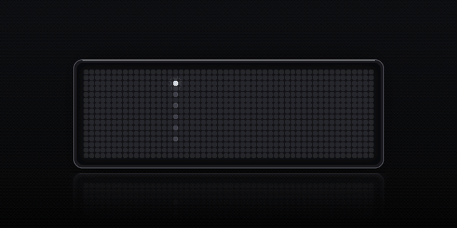

- **Animated 16×16 weather symbol** with pixel-art clouds. All symbols are drawn by the script, so there are no icons to install.
- **Big temperature and humidity** in 6×10 px block digits. The digits drop in one after another, a shine runs across every few seconds, and the temperature is coloured from violet (frost) through green and yellow to red (heat).
  - If both values don't fit side by side, the digits switch to a narrow form and, if needed, the `%` sign is dropped.
  - Humidity can also take turns with the temperature every 4 s, or be hidden.
  - When the temperature stands on its own (humidity `off` or `alternate`), the unit is shown with it: `11°C` or `52°F`. Next to the humidity there is no room for it, so it reads `11°` there.
- **Hourly temperature curve** below, coloured by temperature. It wipes in from the left.
  - **auto** (default): today 0–24 h until 18:00, then the next 24 hours. The current hour pulses in the *today* view.
  - Small ticks mark noon and midnight.
- **Weather you can feel:**
  - The number of raindrops and snowflakes follows the actual amount, from a few drops of drizzle to a downpour.
  - Wind slants rain and snow in the real wind direction, as on a map facing north: a west wind blows them to the right. Clouds drift faster in wind.
  - When the weather code says showers but nothing is falling right now, you get the dry symbol with a single pale drop now and then, instead of a rain animation that doesn't match the view out of the window.

### 2 · Rain

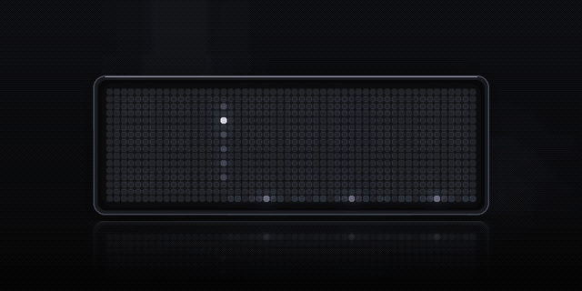

- **When it starts or stops**, in 15-minute steps: `IN 25 MIN`, `AT 17:30`, `ENDS 16:45`, `> 3 H` or `DRY` (German: `IN 25 MIN`, `AB 17:30`, `BIS 16:45`, `> 3 STD`, `TROCKEN`).
- **The next 3 hours as 12 bars.** Height is the amount; colour runs from light blue (drizzle) through blue to violet (heavy rain). Small marks on the base line show full hours.
- **An umbrella:** open with drops splashing off it while it rains, open with a single drop when rain is on its way, furled when it stays dry.

### 3 · Wind

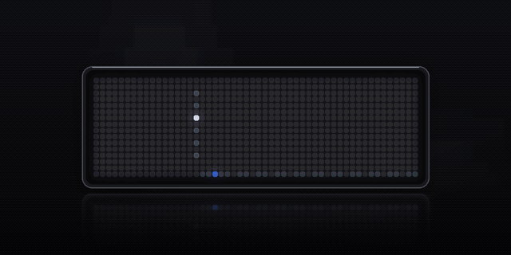

- **A 16×16 wind rose** like a compass: north is marked red. The needle points where the wind blows to, its dim tail where it comes from. When the page opens it swings in from north and settles, then trembles with the gusts; a few specks of air stream across the dial, faster in stronger wind. Below 2 km/h only the hub breathes.
- **Wind speed** in big digits, coloured from grey-blue (calm) through cyan, green, yellow and orange to red (gale) and violet (storm), with the direction beside it (`N`, `NE`, `SW` … – German `NO`, `SO` …, `STILL`/`CALM` when there is no wind).
- **Gusts:** every 4 s the digits cross-fade to the current gusts (`GUST` / `BÖEN`), if they are noticeably stronger than the mean wind.
- **The next 12 hours as bars**, like the rain graph: height and colour are the mean wind, a faint bar above shows the gusts. Midnight and noon are marked on the base line in the tick colours of the weather page.
- Unit: km/h, m/s, mph, knots or Beaufort (setting *Wind unit*).

### 4 · 3-day forecast

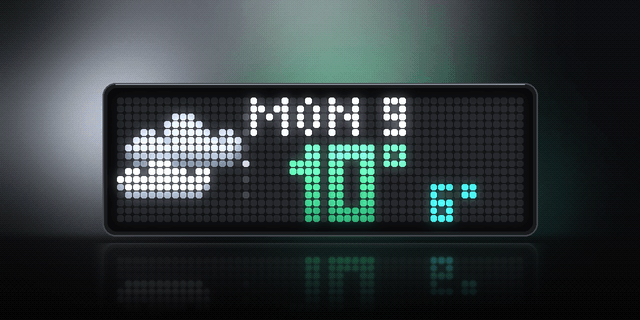

- Tomorrow and the two days after, 3.5 s each; the next day pushes the last one out to the left.
- Weekday and chance of rain (from 10 %) at the top. If there is no rain chance, the day of the month is shown instead.
- Day symbol, the high as big digits in temperature colour, and the low next to it.

### 5 · Sun

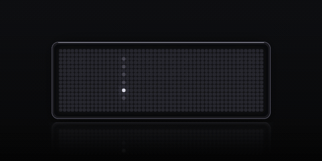

- Sunrise and sunset of today. After sunset it already shows tomorrow's times.
- The next event is lit, the one that has passed is dimmed. The arrows nudge up and down.
- Symbol: the sun on the horizon with breathing rays and glitter on the water.

### 6 · Moon

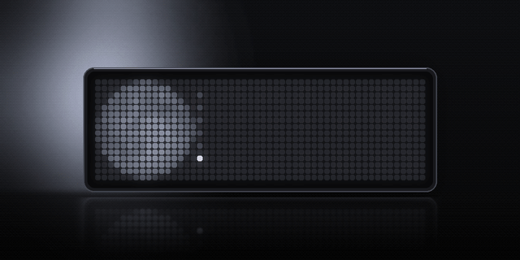

- **Moon phase** as a large **16×16 pixel-art moon**, with a separate picture for each of the eight phases. The phase is calculated on the clock from the true angle between moon and sun, so the lit share matches what your phone or an almanac shows; new and full moon are only shown within about half a day of the event, so a young crescent never looks like a new moon.
- **Moonrise and moonset are calculated on the clock** with a lunar theory accurate to about a minute, with no extra request. The first rise and set from today 0:00 on are shown, or tomorrow's if there is none today.
- **Lit share in %**: every 4 s the rise/set times cross-fade to the illuminated part of the moon in big digits. Below it a **lunar cycle line** runs from new moon (left) over full moon (middle) to the next new moon (right); a pulsing dot marks today, so you also see whether the moon is waxing or waning.
- A soft gleam runs across the lit side. At new moon the moon shows its own picture brightened into a cool grey, so you still see a faint moon with its surface in the dark.

## Requirements

- An **Ulanzi TC002** running **AWTRIX NG** (tested on firmware 1.2.2). The pages need the TC002's **knob**.
- A **52×16** display. The layout is not meant for 32×8 clocks.
- No icons and no API key.

## Installation

### The easy way (recommended): Send to AWTRIX

1. Open the script page on the AWTRIX Hub: **[awtrix.de/script/O3xYAw5TPWWp](https://awtrix.de/script/O3xYAw5TPWWp)**.
2. Press **Send to AWTRIX** and choose your TC002 in the next step.
3. Done – the app is installed and joins the rotation right away.

### Then: set your location

Open the AWTRIX web interface (the clock's IP address or `http://awtrixng-xxxxxx.local`), go to the **Apps** tab, click the **gear** on the Beautiful Weather row and enter **your own latitude and longitude**. Without this you get the weather of Berlin.

### Updates

New versions are announced on the clock itself – once your Hub account is connected:

1. In the AWTRIX web interface open **System → AWTRIX Hub** and enter your **Hub connection key**. You find it in your Hub account settings (**Open Hub account**).
2. Go to the **Scripts** tab and press **Check for updates**. Scripts with a newer version on the Hub are marked there.

### Manual installation

Only if you can't use the button:

1. Open the AWTRIX web interface and go to the **Scripts** tab.
2. Create a new script called **`BeautifulWeather`**, paste the contents of [`BeautifulWeather.ax`](BeautifulWeather.ax) and press **Save**.
3. Set your location as described above.

If the panel shows a red **`ERR:`**, the error message is shown next to the script in the Scripts tab. Please include it in your feedback.

## Settings

All settings are on the **Apps** tab, behind the gear on the *BeautifulWeather* row. Saving restarts the app.

| Setting | Default | What it does |
|---|---|---|
| **Language** | English | `English` or `Deutsch` – texts on the panel (rain page, weekdays, date) |
| **Latitude / Longitude** | 52.52 / 13.40 (Berlin) | Your location. **Set this first.** |
| **Temperature unit** | C | `C` or `F` |
| **Graph** | auto | `auto`: today until 18:00, then the next 24 h · `today`: 0–24 h of the current day · `next24`: the coming 24 hours |
| **Humidity** | beside | `beside` the temperature, `alternate` every 4 s, or `off` |
| **Humidity colour** | #31B8DB | Colour of the humidity value |
| **Wind unit** | km/h | `km/h`, `m/s`, `mph`, `kn` or `Bft` – unit of wind and gusts on the wind page |
| **Windy from** | 30 km/h | On dry days this wind speed or more shows the windy symbol |
| **Cloudy from** | 70 % | Without rain, snow or fog: cloudy from this cloud cover (by day only if the sun is not shining), partly cloudy from half of it |
| **Midnight tick / Noon tick** | #2040A0 / #A08000 | Colours of the ticks above the curve |
| **Page change** | knob | `knob`: turn the knob to switch pages · `auto`: pages change by themselves |
| **Time per page** | 6 s | Auto mode only: how long each page is shown (3-day forecast at least 10.5 s, wind and moon at least 8 s) |
| **Display time** | 10 s | Knob mode: how long the app stays in the rotation. In auto mode the app stays for all its pages |
| **Rain page / Wind page / 3-day forecast / Sun page / Moon page** | on | Switch each knob page on or off. With all of them off the knob keeps its normal function |
| **After turning** | 20 s | Knob mode: after the last turn of the knob the app stays this long, then the rotation moves on |

Times follow the clock's 12/24-hour setting (12-hour times look like `7:45P`).

## Symbols

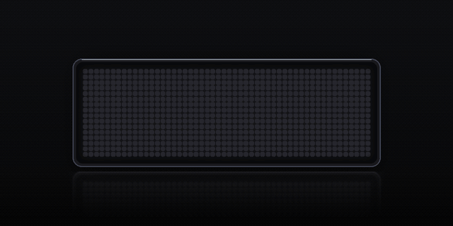

All symbols are **16×16** and animated.

| Condition | WMO codes | Symbol |
|---|---|---|
| Clear (day) | 0 | sun with breathing rays and a glint circling the disc |
| Clear (night) | 0–3 at night, little cloud | crescent, twinkling stars, shooting star |
| Partly cloudy (day / night) | 1–2 | small sun or crescent behind a drifting cloud |
| Cloudy | 3 | a grey cloud behind a light one |
| Fog | 45–48 | drifting fog bands |
| Drizzle | 51–55 | light cloud, a few slow drops |
| Freezing drizzle / rain | 56–57, 66–67 | cloud with drops and flakes |
| Rain | 61–65 | rain cloud, drops with short streaks that splash on the ground |
| Snow | 71–77, 85–86 | light cloud, swaying snowflakes |
| Showers (day / night) | 80–82 | sun or crescent behind a cloud, rain |
| Thunderstorm | 95 | dark cloud, double lightning flash, the cloud lights up |
| Thunderstorm with hail | 96, 99 | cloud, hailstones bouncing off the ground |
| Windy (dry, wind ≥ threshold) | – | gusts with curls running faster in stronger wind |
| Showers about, dry right now | 51–86 with 0 mm | dry symbol, a single pale drop or flake now and then |

## Data and refresh

- One request to Open-Meteo every 15 minutes: current weather with wind and gusts, 15-minute precipitation for the next 4 hours, hourly temperatures, wind and gusts, and the daily forecast with sunrise and sunset. Press the middle button while the app is on screen to refresh right away.
- After a reboot the last known values show at once.
- A red dot at the bottom of the dot column means no successful update for more than 25 minutes.

## Feedback

This is a test release. Useful feedback:

- **Something looks wrong:** a photo of the panel, plus your location, the time and the weather at that moment.
- **The panel shows `ERR:`:** the error text from the Scripts tab.
- **A condition shows the wrong symbol:** the weather you actually had outside.

## Credits

- Moon pictures: the eight 16×16 moon phase icons by **LeonCB** on the AWTRIX Hub ([full-moon](https://awtrix.de/icons/full-moon) and the other phases), embedded in the script.
- Cloud style: after LeonCB's [rainy](https://awtrix.de/icons/rainy-2) icon on the AWTRIX Hub.
- Weather data: [Open-Meteo](https://open-meteo.com) (CC BY 4.0).
- Moonrise/moonset: low-precision lunar theory after Montenbruck & Pfleger, *Astronomy on the Personal Computer*.
- Automatic page change: idea and first version by **DennsDJ** – thank you!
- Firmware: [AWTRIX NG](https://github.com/Blueforcer/awtrix-ng) by Blueforcer.

## Gallery

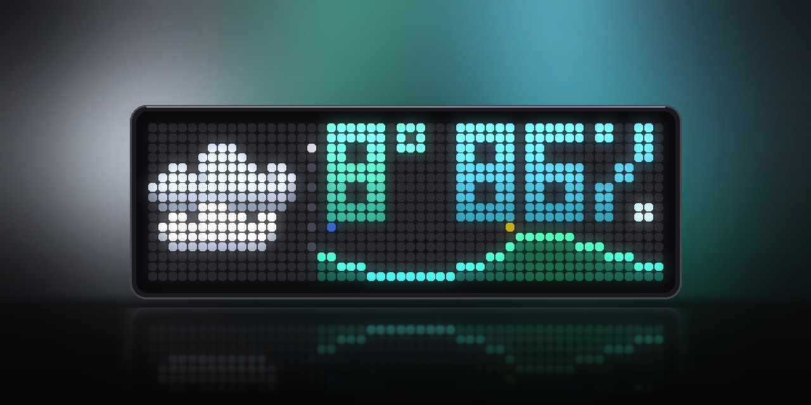
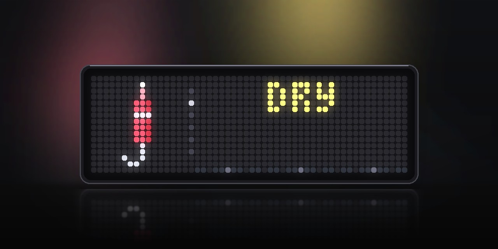
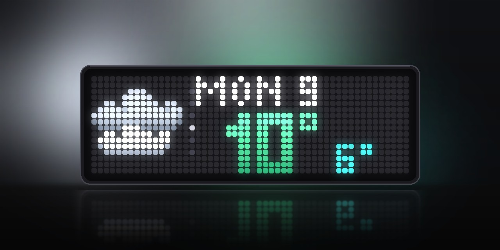
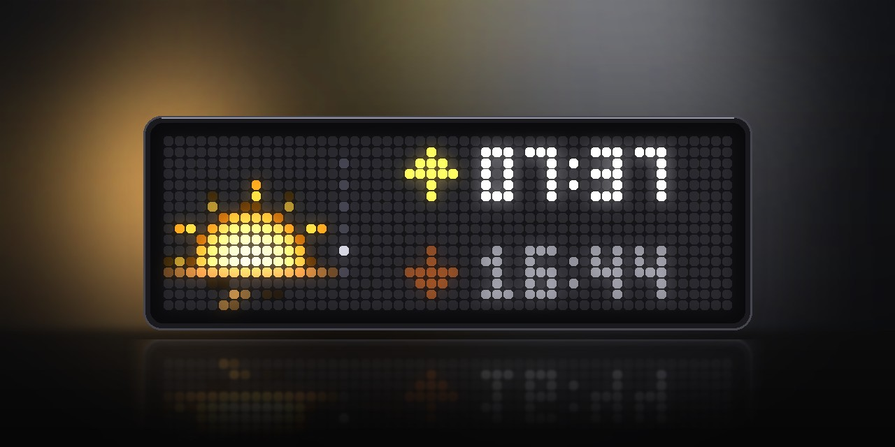
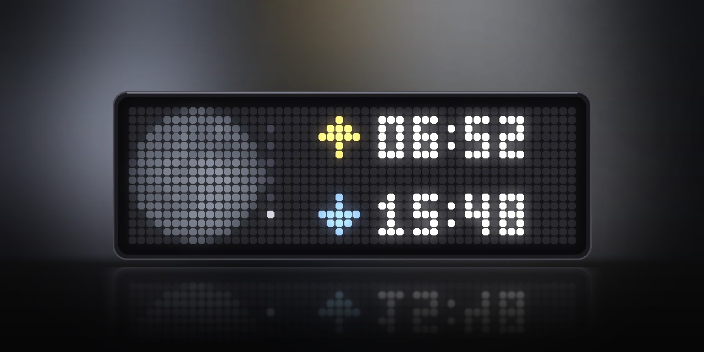
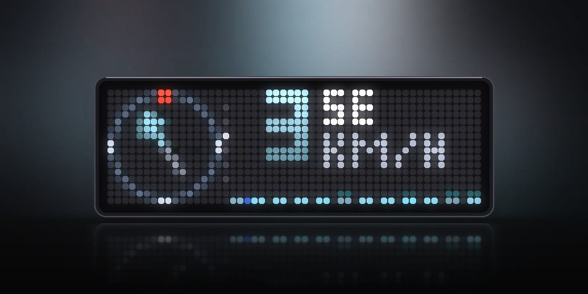
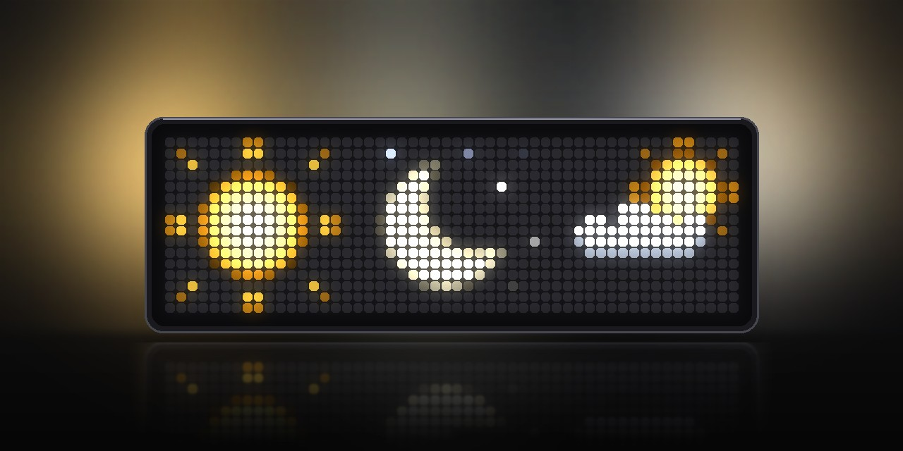

## Changelog

- **2.8** – Moon: the lit share now includes how far the moon stands above or below the sun's path. Around new moon it was up to about half a point too low (0 % instead of 1 %).
- **2.7** – New moon: the moon now glows faintly in a cool grey with its surface texture. Before, with *Moon dark side* at 0 %, no LED lit at new moon. The *Moon dark side* setting is gone, the other phases show their pictures as they are.
- **2.6** – The temperature shows its unit (`11°C`, `52°F`) when it stands on its own, i.e. with humidity `off` or `alternate`, idea by jankete.
- **2.5** – New wind page: wind rose with direction, wind speed and gusts, the next 12 hours as bars, idea by Euphonique. New *Wind unit* setting (km/h, m/s, mph, kn, Bft). Moon: the lit share and phase now come from the true angle between moon and sun (before, from the time since new moon, which could be up to 6 points off), updated every minute.
- **2.4** – New *Page change* setting: pages can now change by themselves (`auto`), idea and first version by DennsDJ. New *Language* setting: panel texts in English or German.
- **2.3** – Moon page: lit share in % with a lunar cycle line, taking turns with moonrise/moonset.
- **2.2** – Sun page (sunrise/sunset) and 3-day forecast page. Times follow the clock's 12/24-hour setting.
- **2.1** – Rain page for the next 3 hours, page dots, raindrops and snowflakes follow the real amount and the wind.
- **2.0** – Pages are now changed with the knob instead of switching automatically. No sound.
- **1.x** – First versions: 16×16 symbols, moon page, humidity, showers-about hint, pixel-art clouds.

## License

[CC BY-NC 4.0](../LICENSE) – free to use, share and modify with credit to **Hank_the_Tank**, not for commercial use. The license covers the code; the moon phase pictures are by **LeonCB** (see *Credits*) and remain his work.
