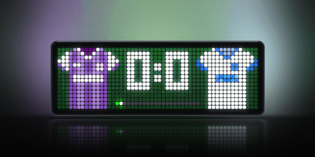
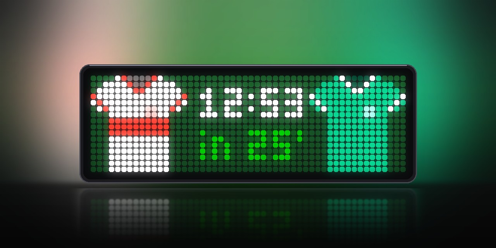
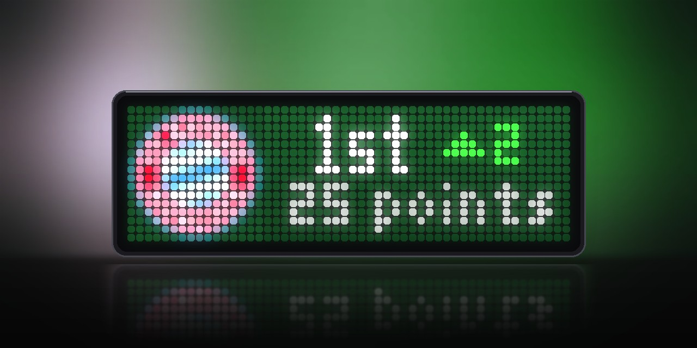
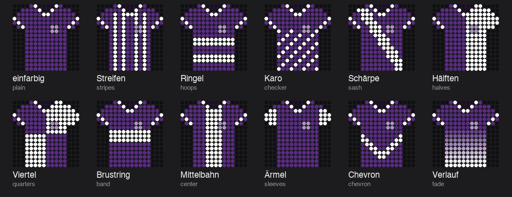
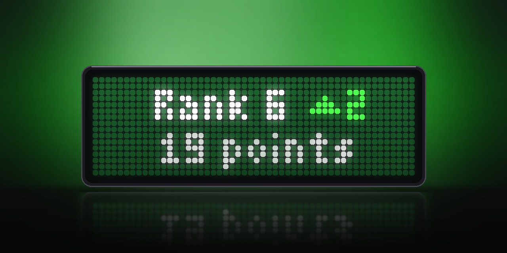
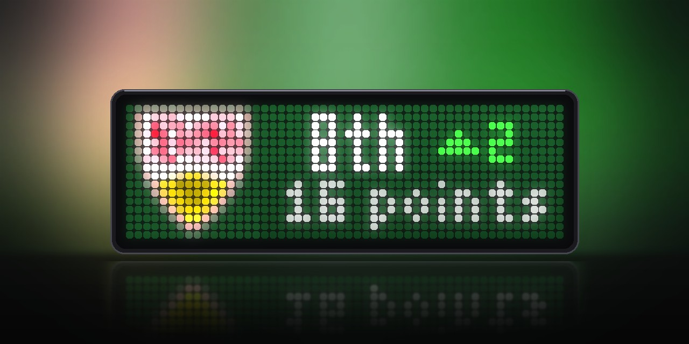

# LiveScore for AWTRIX NG (Ulanzi TC002)

**Version 2.8** · by Hank_the_Tank / Claude · for the **52×16 panel** of the Ulanzi TC002



**Install from the AWTRIX Hub:** [https://awtrix.de/script/q3feTbek0lRu](https://awtrix.de/script/q3feTbek0lRu)

The live score of **your favourite football team**, with both teams' kits on either side and a bar that fills up with the match time. Every goal gets a celebration: fireworks, confetti and a stadium jingle. The referee's whistle marks kick-off, half-time and full time. The data comes from ESPN's public scoreboard API, so you don't need an API key or an account.

**New in 2.8: wear the kits the community designs.** Every team can wear a 16×16 kit image instead of the drawn kit: your own design, or one shared by other fans on the AWTRIX Hub. Name it `kit-<ESPN ID>` and it shows up automatically, for your team *and* for your opponents. See *Kits by the community* below.

The app **only joins the rotation around your team's matches**: a preview before kick-off, the live match, and the final score with stats, league position and the next fixture. On all other days it stays out of the way, or, if you like, shows your league position.

```
┌──────────┬────────────────────┬──────────┐
│   ▄██▄   │                    │   ▄██▄   │
│ ████████ │      2  :  1       │ ████████ │  ← home kit · score · away kit
│   ████   │                    │   ████   │
│   ████   │  ▬▬▬▬▬▬▬▬▬▬▭▭▭▭▭▭  │   ████   │  ← match time (22 cells = 90 min)
└──────────┴────────────────────┴──────────┘
```

## Features

- **Kits by the community (new in 2.8).** Any 16×16 kit icon on your clock named `kit-<ESPN ID>` (e.g. `kit-132` for Bayern) is worn automatically by that team, whether it is yours or the opponent. Want a different design for your team? Type any icon name into *Kit image*. Draw your own in the Hub Studio and share it, so every fan of your club can wear it.
- **All competitions.** League, cups and European games. The app skips its turn in the rotation until shortly before kick-off.
- **Preview before kick-off.** Up to an hour before (adjustable), both kits fly in with the kick-off time in your local time and a countdown (`in 42'`, then `4:59` in the last ten minutes).
- **Two teams.** Follow your club and your national team, for example, each with its own kit settings. The app shows whichever match comes first.
- **Both kits.** Home left, away right. Every team wears its `kit-<ESPN ID>` icon if it is on your clock (see *Kits by the community*). Otherwise the kit is drawn: the opponent in its ESPN colours, your team in its ESPN colours or your own colours with one of 12 patterns (stripes, hoops, sash, halves, chevron, fade …). Colours too dark for the LEDs are lightened.
- **Big score and match time bar.** 6×10 px block digits (narrower for double digits). The bar is green while the match is on, amber at half-time, orange in extra time and grey after the final whistle.
- **Animated.** The kits fly in, the score drops into place, a shine sweeps across, and the colon and the tip of the bar pulse while the match is live.
- **Goal celebration for your team.** A flash, your kit jumps, a rainbow **GOAL!** pops in letter by letter, three fireworks burst in your colours, confetti falls, and the new digit bounces in while a synthesized stadium jingle plays. A goal for the opponent gets a dimmed *GOAL* and a sad trombone.
- **VAR.** If a goal is ruled out, the referee draws the VAR screen in the air, *VAR* turns red and the corrected digit glows red and shakes.
- **Goal scorer and card banners.** A TV-style banner slides up: the minute in a box in the team's colour and the player next to it (e.g. `89'` · `M. Merino`), with *(pen)* or *(o.g.)*. For a card, the referee holds up the yellow or red card above the minute. A red card brings the app to the front; a yellow one waits for the app's next turn. Every red card also leaves a small red card on that team's kit.
- **Browse the match.** While the app is on screen, turn the knob (or press left/right) to replay every goal and card as a banner, the latest first.
- **Penalty shootout.** Every penalty scored adds a green dot under the score. ESPN does not list misses, so only goals are shown.
- **Half-time stats.** The app alternates between the score and a page with possession (a bar in both teams' colours) and shots.
- **Final score.** It stays in the rotation for 15 minutes. A win brings confetti in your club colours and a victory fanfare; the losing kit turns grey (a kit image stays as it is). The app cycles through the score, the stats, your **league position** with its change (`Rank 3 ▲2` · `27 points`, leagues only) and your **next match** (`Sat 15:30` · `@ Mainz`).
- **Referee whistles.** One at kick-off and after the break, two at half-time, three at full time.
- **Goal announcement.** After the jingle, the clock calls out *"Goal! Goal! Goal! Dortmund!"* (or *"No goal!"* after VAR). With *Language* set to `Deutsch` and a German voice pack on the clock, it calls *"Tor! Tor! Tor! Osnabrück!"* and uses German names where ESPN has English ones (Cologne → Köln, Netherlands → Niederlande). For any other voice pack, type your own calls, e.g. *"Doelpunt! {team}!"* in Dutch. Voice packs are available in [Blueforcer's shop](https://ko-fi.com/blueforcer/shop).
- **League position between matches (optional).** Without a match the app stays in the rotation with your kit or club crest, your position in big digits with an arrow for the change since the last matchday (`10. ▲2`) and your points. During the preview before kick-off it alternates with the countdown. Switch it off and the app disappears again until the next match.
- **Quiet hours.** No sound between two hours of your choice; the animations still run.
- **MQTT for your smart home.** Every event is published as JSON, e.g. to flash your lights in your club colours on every goal. See *MQTT and Home Assistant* below.
- **Light on the network.** Fixtures every 30 minutes, the score every 30 s while the match is on. Press the middle button to update right away.

## Requirements

- An **Ulanzi TC002** running **AWTRIX NG** **firmware 1.1.6 or newer** (tested on 1.2.3). On older firmware the display works, but sounds and the announcement may stay silent.
- A **52×16** display. The layout is not meant for 32×8 clocks.
- No icons are needed. Kits and digits are drawn in code; kit icons (`kit-<ESPN ID>`) are optional.

## Installation

### The easy way (recommended): Send to AWTRIX

1. Open [LiveScore on the AWTRIX Hub](https://awtrix.de/script/q3feTbek0lRu).
2. Press **Send to AWTRIX** and choose your TC002 in the next step.
3. Done. The app is installed. It stays hidden until your team plays.

### Then: make it yours

Open the AWTRIX web interface (the clock's IP address or `http://awtrixng-xxxxxx.local`), go to the **Apps** tab and click the **gear** on the LiveScore row. The one thing you have to set is **your team's ESPN ID** (see below). Without it you follow Bayern Munich. There you can also add a **second team** and choose kit colours, language, quiet hours and more (see *Settings*).

As long as your team isn't playing, you won't see the app. That is intended: it shows up an hour before kick-off.

### Updates

New versions are announced on the clock itself once your Hub account is connected:

1. In the AWTRIX web interface open **System → AWTRIX Hub** and enter your **Hub connection key**. You find it in your Hub account settings (**Open Hub account**).
2. Go to the **Scripts** tab and press **Check for updates**. Scripts with a newer version on the Hub are marked there.

### Manual installation

Only if you can't use the button: in the AWTRIX web interface open the **Scripts** tab, create a script called **`LiveScore`**, paste the contents of [`LiveScore.ax`](LiveScore.ax) and press **Save**.

### Finding your team's ESPN ID

Search for your team on [espn.com](https://www.espn.com/soccer/) and open its club page. The ID is the number in the address:

`https://www.espn.com/soccer/club/_/id/`**`124`**`/borussia-dortmund` → **124**

Examples: Bayern Munich 132 · Borussia Dortmund 124 · Real Madrid 86 · Barcelona 83 · Liverpool 364 · Arsenal 359 · Manchester City 382.

## Settings

All settings are behind the gear on the *LiveScore* row of the **Apps** tab, in three groups: **My Team**, **Team 2** and **Settings**. Saving restarts the app.

| Setting | Default | What it does |
|---|---|---|
| **ESPN team ID** | 132 (Bayern Munich) | Your team. **Set this first.** |
| **Kit colour / trim / pattern** | red / white / plain | Your own kit, used when *ESPN colours* is off. Patterns: `plain`, `stripes`, `hoops`, `checker`, `sash`, `halves`, `quarters`, `band`, `center`, `sleeves`, `chevron`, `fade` |
| **ESPN colours for my team** | on | For the drawn kit, i.e. when your team wears no kit image. Off: use your own colours, e.g. when ESPN has none for your club |
| **Kit image (my team)** | empty | Name of a 16×16 icon on your clock (without `.gif`), worn instead of the drawn kit. **Empty = automatic:** the icon `kit-<ESPN ID>` if it is on the clock, otherwise the drawn kit in ESPN colours or your own colours. See *Kits by the community* |
| **Second team** + kit settings | empty | Optional second team (e.g. your national team) with its own kit and its own *Kit image* |
| **Update during the match** | 30 s | How often the score is checked (15–300 s) |
| **Show final score** | 15 min | How long the result stays. `0` hides the app right away |
| **Preview before kick-off** | 60 min | When the kits and countdown appear. `0` = from kick-off |
| **Stats, table, next match** | on | Stats at half-time; after full time also league position and next match |
| **League position between matches** | off | Shows your first team's position and points when no match is on. Off: the app only appears around matches. Not for national teams |
| **Show with the league position** | kit | `kit` or `crest`: the club crest from ESPN (loaded once through the image service wsrv.nl; your kit is shown until it has arrived) |
| **Include friendlies** | off | ESPN often doesn't update friendlies live |
| **Jump in at kick-off, goals and full time** | on | Brings the app to the front for these moments and VAR decisions |
| **Browse goals and cards** | knob | `off`, `knob`, `buttons` or `both`. With buttons, left/right don't switch apps while LiveScore shows a match with events |
| **Sound** | all | `off`, `effects` (whistles, jingles), `mine` (plus announcements for your goals), `all` (also the opponent's) |
| **Language** | English | `English` or `Deutsch` for texts and announcements. German announcements need a German voice pack |
| **Custom goal call** | empty | Your own goal call, for a voice pack in another language, e.g. `Doelpunt! {team}!`. `{team}` becomes the team that scored; without it the name is added at the end. Empty = the call of the chosen *Language* |
| **Custom no-goal call** | empty | Your own call when VAR rules out a goal, e.g. `Geen doelpunt!`. Empty = the call of the chosen *Language* |
| **Quiet from / until** | 0 / 0 | No sound between these hours (e.g. 22 and 7). Same hour = off |
| **Score / Match time bar** | white / green | Colours of the digits and the bar |
| **Background** | grass | `black`, `navy`, `anthracite`, `grass`, `bordeaux` or `petrol` gradient |
| **MQTT topic** | empty | Optional, see *MQTT and Home Assistant* |

## Kits by the community

LiveScore draws every kit itself, but it looks much better in a real design. Since 2.8 a team can wear a **16×16 kit image**, and the AWTRIX Hub is the wardrobe: the more fans share their kits, the more teams look right on every clock.

### Wear a kit

- **Automatically:** install an icon called **`kit-<ESPN ID>`** on your clock, e.g. `kit-132` (Bayern Munich) or `kit-481` (Germany). That team wears it in every match, whether it is your team or the opponent. On the icon's Hub page press **Send to AWTRIX**. Nothing to set.
- **Your pick for your own teams:** type any icon name into **Kit image (my team)** or **Kit image (team 2)**, e.g. a retro design or a third kit. This wins over `kit-<ID>`. Press **Copy name** on the Hub page to get the name exactly right.
- No icon? The drawn kit is used as before, in ESPN colours or your own colours.
- **An empty *Kit image* does not mean ESPN colours.** It means automatic: a `kit-<ESPN ID>` icon on the clock always wins over the drawn kit. To see the drawn kit again, delete that icon from the clock (icon gallery in the AWTRIX web interface).

### Design and share a kit

1. **Start from the template:** open the [kit template](https://awtrix.de/icons/kit-template) on the Hub and press **Make a variation** (you need to be signed in). It opens the 16×16 kit shape in the Studio. Paint inside the grey area: anything outside the shape is cut off, so all kits line up, and the area around the kit is replaced by the app's background.
2. **Share it:** name it **`kit-<ESPN ID>`** (e.g. `kit-132`) and check that **Copy name** on its page shows exactly that name. Then every LiveScore user who installs it gets it automatically. The ESPN ID is explained under *Finding your team's ESPN ID*.
3. Names on the Hub are unique, so a second design for the same club gets a suffix (`kit-132-2`). Those are worn through the *Kit image* setting. Mention new kits in the LiveScore discussion so others find them.

- A kit image flies in, jumps when its team scores and carries its red cards like the drawn kit. It stays as it is when its team loses, and the shine sweep leaves it alone.
- Sparks, the new digit after a goal and the stats bar use the team's **kit colours**: ESPN's for the opponent, your *Kit colour* / *Kit trim* (or ESPN's) for your team. For your own teams, set them to the main colours of your design.
- Kit images cost no network traffic: the app only looks for the icon on the clock.

## Good to know

- **ESPN coverage.** Top leagues, second divisions, cups and European competitions are covered well. Lower leagues and friendlies may show up late or not at all.
- **Some clubs have no colours on ESPN.** VfL Osnabrück, for example, is black on black. Turn *ESPN colours for my team* off and pick your own.
- **The minute is approximate.** Between ESPN updates the bar moves on its own and corrects itself at the next update.
- **Postponed or cancelled matches** are skipped, and so is a match that hasn't kicked off four hours after its planned start.
- **League position** appears only when ESPN has a table and has counted the match. The app asks for up to ten minutes after the final whistle.
- The app sends the user agent `curl/8.7.1`, because ESPN rejects some others with *403 Forbidden*.

## MQTT and Home Assistant

On every event (kick-off, goal, card, VAR, full time …) LiveScore sends a short JSON message to your MQTT broker. It doesn't control any lights itself: it reports *"goal!"*, and you decide in Home Assistant (or Node-RED, ioBroker …) what happens. The feature is off until you enter a topic.

### Setup

1. **Connect the clock to your broker:** in the web interface open **System → MQTT**, switch on **Enable MQTT** and enter **Broker host**, **Broker port** (usually `1883`), **Username** and **Password**. **Connection** should then read *Connected*. The **Topic prefix** there does not apply to LiveScore.
2. **Enter a topic in LiveScore:** **Apps** tab → gear → **MQTT topic**, e.g. `awtrix/livescore`. It is used exactly as typed (case matters).
3. **Check:** in Home Assistant open **Settings → Devices & services → MQTT → Configure**, *Listen to a topic*. Messages arrive while your team plays.

### The messages

```json
{"event":"goal","home":"Osnabrück","away":"Kaiserslautern","score":"1:0","team":"Osnabrück","mine":true,"color":"#8A3AFF"}
```

| `event` | When | Extra fields |
|---|---|---|
| `kickoff`, `halftime`, `restart` | Whistles | – |
| `goal` | Right when a goal is detected | `team`, `mine`, `color` |
| `scorer` | Once ESPN names the player | `team`, `mine`, `color`, `minute`, `player` |
| `var` | A goal was ruled out (`team` = whose goal) | `team`, `mine`, `color` |
| `yellow_card`, `red_card` | Booking or sending-off | `team`, `mine`, `color`, `minute`, `player` |
| `penalty` | Penalty scored in the shootout | `team`, `mine`, `color` |
| `fulltime` | Final whistle | `result`: `win`, `draw` or `loss` (for your team) |

Every message also has `home`, `away` and `score`. **`mine`** is `true` when the event is about your team. **`color`** is that team's kit colour as `#RRGGBB`, brightened for lamps.

### Example: lights flash in your club colours on every goal

**Settings → Automations & scenes → Create automation → ⋮ → Edit in YAML**, paste this and replace the topic and `light.living_room`:

```yaml
alias: LiveScore – my team scores
mode: single
triggers:
  - trigger: mqtt
    topic: awtrix/livescore
conditions:
  - condition: template
    value_template: "{{ trigger.payload_json.event == 'goal' and trigger.payload_json.mine }}"
actions:
  - action: scene.create            # remember the current light
    data:
      scene_id: before_the_goal
      snapshot_entities:
        - light.living_room
  - repeat:                         # flash three times in the club colour
      count: 3
      sequence:
        - action: light.turn_on
          target:
            entity_id: light.living_room
          data:
            rgb_color: >-
              {{ [trigger.payload_json.color[1:3] | int(base=16),
                  trigger.payload_json.color[3:5] | int(base=16),
                  trigger.payload_json.color[5:7] | int(base=16)] }}
            brightness: 255
            transition: 0
        - delay: 0.5
        - action: light.turn_off
          target:
            entity_id: light.living_room
          data:
            transition: 0
        - delay: 0.5
  - action: scene.turn_on           # back to how it was
    target:
      entity_id: scene.before_the_goal
```

**Test it without a match:** under **MQTT → Configure → Publish a packet**, send the goal message above to your topic. The lights should flash purple three times. If nothing happens, the automation's **⋮ → Traces** shows where it stopped.

**More ideas** – change only the condition: a win (`event == 'fulltime' and result == 'win'`), a red card for your team (`event == 'red_card' and mine`), VAR ruling out the opponent's goal (`event == 'var' and not mine`) or kick-off (`event == 'kickoff'`).

Messages are sent whether or not LiveScore is on screen, also during quiet hours, and are not retained.

## Gallery










## Changelog

- **2.8** – **Kits by the community:** a 16×16 icon named `kit-<ESPN ID>` on the clock is worn automatically by that team, also by the opponent. New *Kit image* setting per team for any other icon. Share your kit designs as icons on the AWTRIX Hub.
- **2.7** – Custom goal and no-goal calls, so the announcement works with voice packs in any language (thanks to goldstrike053 for the idea). The display keeps its own *Language*.
- **2.6** – Preview with kick-off time and countdown. VAR animation. Penalty shootout dots. Half-time stats. After full time: confetti and fanfare for a win, grey loser kit, league position, next match. Red cards stay on the kit. Browse goals and cards with the knob or buttons. Second team, quiet hours, MQTT events, *Language* setting (English/German). Optional league position between matches. The background gradient is gentler, so the bottom rows no longer go dark. Two goals or several cards between two updates are no longer lost. Fixes: the opponent's name could be "Goals" before kick-off; club names without umlauts (Osnabruck, Koln …) are now shown and announced correctly, and in German English club and country names are replaced (Cologne → Köln).
- **2.5** – Taller goal and card banners, so descenders in player names are no longer cut off.
- **2.4** – Card banners with an animated card. *Background* setting with five gradients.
- **2.3** – Goal scorer banner (idea from a LiveScore user).
- **2.2** – Cleaner digit 1.
- **2.1** – Eight new kit patterns. Safer goal detection.
- **2.0** – Animations, goal celebration with fireworks and stadium jingle, referee whistles.
- **1.1** – Spoken goal announcement.
- **1.0** – First release.

## License

[CC BY-NC 4.0](../LICENSE) – free to use, share and modify with credit to **Hank_the_Tank**, not for commercial use.
