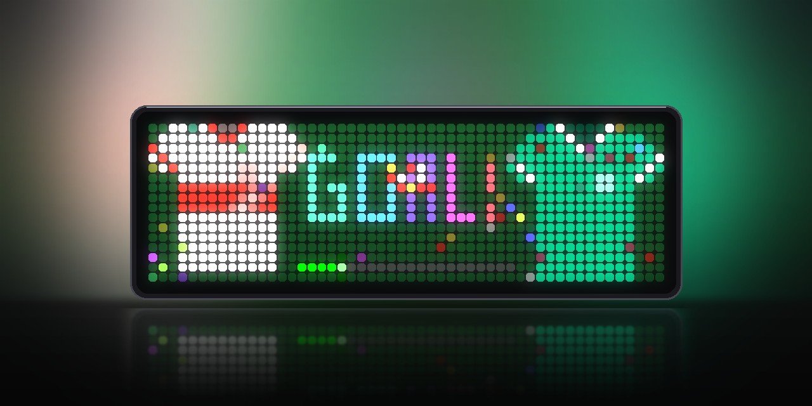
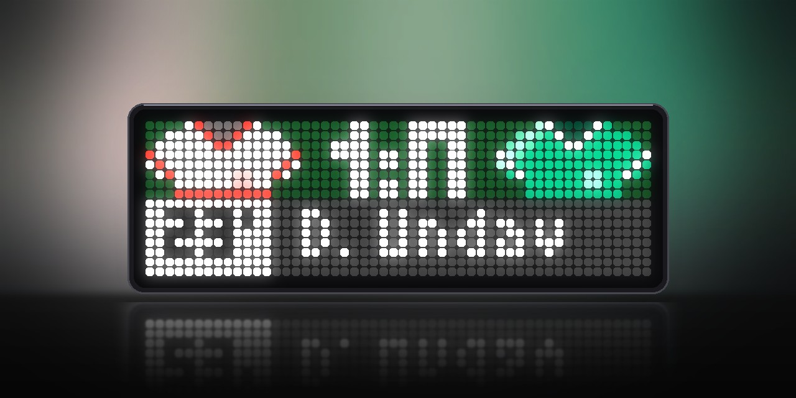
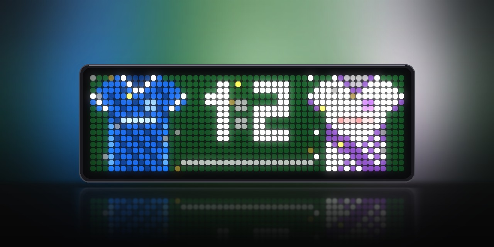
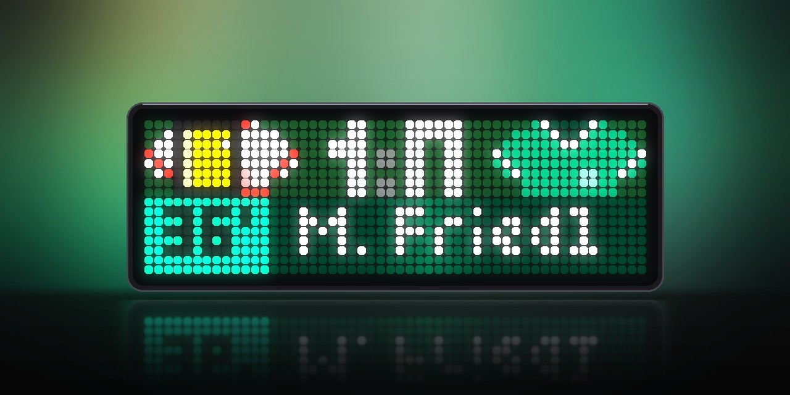
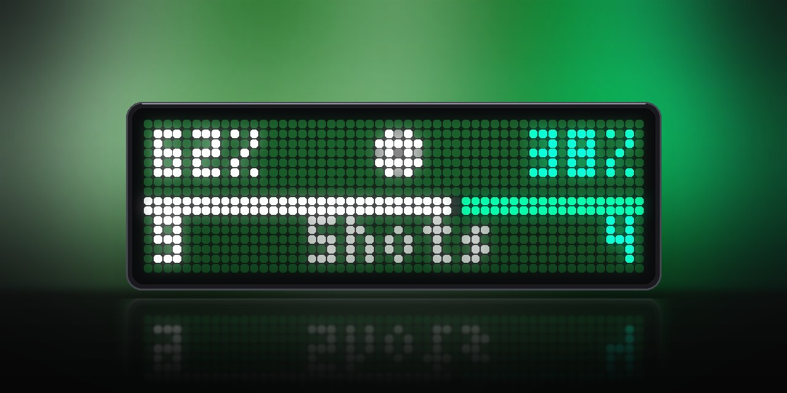
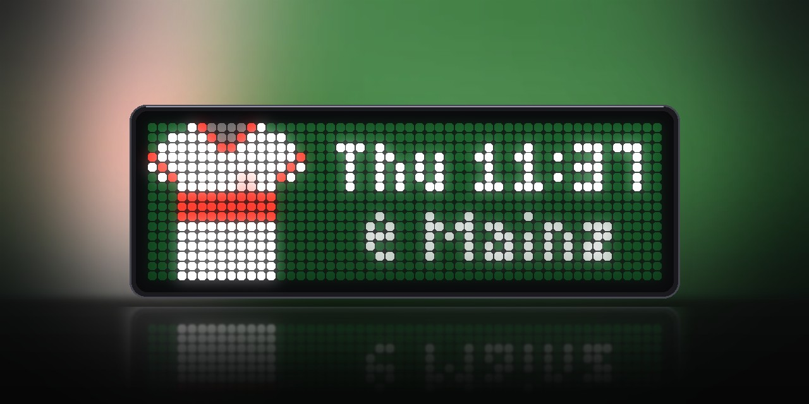

# LiveScore for AWTRIX NG (Ulanzi TC002)

**Version 3.0** · by Hank_the_Tank / Claude · for the **52×16 panel** of the Ulanzi TC002


**Install from the AWTRIX Hub:** [https://awtrix.de/script/q3feTbek0lRu](https://awtrix.de/script/q3feTbek0lRu) (press **Send to AWTRIX**). Manual installation: in the AWTRIX web interface open the **Scripts** tab, create a script called **`LiveScore`**, paste the contents of [`LiveScore.ax`](LiveScore.ax) and press **Save**.

The live score of **your favourite football team**, with both teams' kits on either side and a bar that fills up with the match time. Every goal gets a celebration: fireworks, confetti and a stadium jingle. The referee's whistle marks kick-off, half-time and full time. The data comes from ESPN's public scoreboard API, so you don't need an API key or an account.

**Home *and* away kits from the community.** Every team can wear a 16×16 kit image from the AWTRIX Hub instead of the drawn kit: `kit-<ESPN ID>` at home, `kit-<ESPN ID>-away` away, automatically for your team *and* your opponents. See *Kits by the community*.

The app **only joins the rotation around your team's matches**: a preview before kick-off, the live match, and the final score with stats, league position and the next fixture. On all other days it stays out of the way, or, if you like, shows your league position.

```
┌──────────┬────────────────────┬──────────┐
│   ▄██▄   │                    │   ▄██▄   │
│ ████████ │      2  :  1       │ ████████ │  ← home kit · score · away kit
│   ████   │                    │   ████   │
│   ████   │  ▬▬▬▬▬▬▬▬▬▬▭▭▭▭▭▭  │   ████   │  ← match time (22 cells = 90 min)
└──────────┴────────────────────┴──────────┘
```

## Features

- **All competitions.** League, cups and European games. The app skips its turn in the rotation until shortly before kick-off.
- **Preview before kick-off.** Up to an hour before (adjustable), both kits fly in with the kick-off time in your local time and a countdown (`in 42'`, then `4:59` in the last ten minutes).
- **Two teams.** Follow your club and your national team, for example, each with its own kit settings. The app shows whichever match comes first.
- **Both kits, home left, away right.** Kit icons from the community (`kit-<ESPN ID>`, away `kit-<ESPN ID>-away`) are worn automatically, see *Kits by the community*. Otherwise the kit is drawn: the opponent in ESPN colours, your team in ESPN colours or your own with one of 12 patterns (stripes, hoops, sash, halves, chevron, fade …). Colours too dark for the LEDs are lightened.
- **Big score and match time bar.** 6×10 px block digits (narrower for double digits). The bar is green while the match is on, amber at half-time, orange in extra time and grey after the final whistle.
- **Animated.** The kits fly in, the score drops into place, a shine sweeps across, and the colon and the tip of the bar pulse while the match is live.
- **Goal celebration for your team.** A flash, your kit jumps, a rainbow **GOAL!** pops in letter by letter, fireworks in your colours, confetti and a stadium jingle. The opponent's goal gets a dimmed *GOAL* and a sad trombone.
- **VAR.** If a goal is ruled out, the referee draws the VAR screen in the air, *VAR* turns red and the corrected digit glows red and shakes.
- **Goal scorer and card banners.** A TV-style banner slides up: the minute in the team's colour and the player (`89'` · `M. Merino`), with *(pen)* or *(o.g.)*. For a card the referee holds it up. A red card brings the app to the front and stays as a small red card on the kit.
- **Browse the match.** While the app is on screen, turn the knob (or press left/right) to replay every goal and card as a banner, the latest first.
- **Penalty shootout.** Every penalty scored adds a green dot under the score. ESPN does not list misses, so only goals are shown.
- **Half-time stats.** The app alternates between the score and a page with possession (a bar in both teams' colours) and shots.
- **Final score.** Stays for 15 minutes. A win brings confetti and a fanfare; the losing kit turns grey (a kit image stays as it is). Then score, stats, **league position** with its change (`Rank 3 ▲2` · `27 points`) and **next match** (`Sat 15:30` · `@ Mainz`) take turns.
- **Referee whistles.** One at kick-off and after the break, two at half-time, three at full time.
- **Goal announcement.** After the jingle the clock calls *"Goal! Goal! Goal! Dortmund!"* (or *"No goal!"* after VAR). With *Language* `Deutsch` and a German voice pack: *"Tor! Tor! Tor! Osnabrück!"* with German names (Cologne → Köln). For other voice packs type your own call, e.g. *"Doelpunt! {team}!"*. Voice packs are available in [Blueforcer's shop](https://ko-fi.com/blueforcer/shop).
- **League position between matches (optional).** Without a match the app shows your kit or club crest, your position with an arrow for the change (`10. ▲2`) and your points.
- **Quiet hours.** No sound between two hours of your choice; the animations still run.
- **MQTT for your smart home.** Every event is published as JSON, e.g. to flash your lights in your club colours on every goal. See *MQTT and Home Assistant* below.
- **Light on the network.** Fixtures every 30 minutes, the score every 30 s while the match is on. Press the middle button to update right away.

## Requirements

- An **Ulanzi TC002** running **AWTRIX NG** **firmware 1.1.6 or newer** (tested on 1.2.3). On older firmware the display works, but sounds and the announcement may stay silent.
- A **52×16** display. The layout is not meant for 32×8 clocks.
- No icons are needed; kit icons are optional.

## Finding your team's ESPN ID

Search for your team on [espn.com](https://www.espn.com/soccer/) and open its club page. The ID is the number in the address:

`https://www.espn.com/soccer/club/_/id/`**`124`**`/borussia-dortmund` → **124**

Examples: Bayern Munich 132 · Borussia Dortmund 124 · Real Madrid 86 · Barcelona 83 · Liverpool 364 · Arsenal 359 · Manchester City 382.

National teams: Germany 481 · Netherlands 449 · England 448 · France 478 · Spain 164 · Italy 162 · Brazil 205 · South Korea 451.

**Check an ID:** `https://site.api.espn.com/apis/site/v2/sports/soccer/all/teams/<ID>` shows the team's name. One swapped digit is another team (451 South Korea, 541 Partizan Belgrade).

## Settings

All settings are behind the gear on the *LiveScore* row of the **Apps** tab, in three groups: **My Team**, **Team 2** and **Settings**. Saving restarts the app.

| Setting | Default | What it does |
|---|---|---|
| **ESPN team ID** | 132 (Bayern Munich) | Your team. **Set this first.** |
| **Kit colour / trim / pattern** | red / white / plain | Your own kit, used when *ESPN colours* is off. Patterns: `plain`, `stripes`, `hoops`, `checker`, `sash`, `halves`, `quarters`, `band`, `center`, `sleeves`, `chevron`, `fade` |
| **ESPN colours for my team** | on | For the drawn kit, i.e. when your team wears no kit image. Off: use your own colours, e.g. when ESPN has none for your club |
| **Kit image (my team)** | empty | 16×16 icon on your clock instead of the drawn kit. One name for both, or two: `home, away` (e.g. `kit-481-3, kit-481-away-2`). **Empty = automatic**, see *Kits by the community* |
| **Second team** + kit settings | empty | Optional second team (e.g. your national team) with its own kit and its own *Kit image* |
| **Update during the match** | 30 s | How often the score is checked (15–300 s) |
| **Show final score** | 15 min | How long the result stays. `0` hides the app right away |
| **Preview before kick-off** | 60 min | When the kits and countdown appear. `0` = from kick-off |
| **Stats, table, next match** | on | Stats at half-time; after full time also league position and next match |
| **League position between matches** | off | Shows your first team's position and points when no match is on. Off: the app only appears around matches. Not for national teams |
| **Show with the league position** | kit | `kit` or `crest`: the club crest from ESPN (loaded once through the image service wsrv.nl; your kit is shown until it has arrived) |
| **Include friendlies** | off | ESPN often doesn't update friendlies live |
| **Jump in at kick-off, goals and full time** | on | Brings the app to the front for these moments and VAR decisions |
| **Browse goals and cards** | knob | `off`, `knob`, `buttons` or `both`. With buttons, left/right don't switch apps while LiveScore shows a match with events |
| **Sound** | all | `off`, `effects` (whistles, jingles), `mine` (plus announcements for your goals), `all` (also the opponent's) |
| **Language** | English | `English` or `Deutsch` for texts and announcements. German announcements need a German voice pack |
| **Custom goal call** | empty | Your own goal call, for a voice pack in another language, e.g. `Doelpunt! {team}!`. `{team}` becomes the team that scored; without it the name is added at the end. Empty = the call of the chosen *Language* |
| **Custom no-goal call** | empty | Your own call when VAR rules out a goal, e.g. `Geen doelpunt!`. Empty = the call of the chosen *Language* |
| **Quiet from / until** | 0 / 0 | No sound between these hours (e.g. 22 and 7). Same hour = off |
| **Score / Match time bar** | white / green | Colours of the digits and the bar |
| **Background** | grass | `black`, `navy`, `anthracite`, `grass`, `bordeaux` or `petrol` gradient |
| **MQTT topic** | empty | Optional, see *MQTT and Home Assistant* |

## Kits by the community

LiveScore draws every kit itself, but a real design looks much better. A team can wear a **16×16 kit image**, and the AWTRIX Hub is the wardrobe: the more fans share kits, the more teams look right on every clock.

### Wear a kit

- **Automatically:** install the icon **`kit-<ESPN ID>`** (e.g. `kit-132` Bayern, `kit-481` Germany) with **Send to AWTRIX** on its Hub page. That team wears it in every match, yours or the opponent. Nothing to set.
- **Away kit (new in 2.9):** **`kit-<ESPN ID>-away`** (e.g. `kit-132-away`) is worn when that team is the away side (right). Without it, `kit-<ESPN ID>` is worn away too.
- **Only the name counts, not the title:** the app looks for what **Copy name** shows on the Hub page (= the file name on your clock).
- **Your pick for your own teams:** type an icon name into **Kit image (my team)** / **(team 2)**, e.g. a retro kit or one with a suffix like `kit-481-3`. One name is worn home and away. **New in 3.0: two names, `home, away`**, e.g. `kit-481-3, kit-481-away-2`. Leave one side empty for automatic there: `, kit-481-away-2` picks only the away kit.
- No icon? The drawn kit, as before. An empty *Kit image* means automatic, not ESPN colours: to get the drawn kit back, delete the `kit-…` icon from the clock (icon gallery in the web interface).

### Design and share a kit

1. Open the [kit template](https://awtrix.de/icons/kit-template) and press **Make a variation** (signed in). Paint inside the grey area; anything outside is cut off and replaced by the app's background.
2. Give it the title **`kit-<ESPN ID>`** (home) or **`kit-<ESPN ID>-away`** (away), nothing more. Check the ID first (see *Finding your team's ESPN ID*), and after uploading check that **Copy name** shows exactly that name.
3. **The name is fixed at the first upload**, made from the title you typed. Renaming the title later doesn't change it; a wrong name needs a new upload.
4. Names are unique, so a second design gets a suffix (`kit-132-2`), worn through *Kit image* (home, away or both). Mention new kits in the LiveScore discussion.

A kit image flies in, jumps for goals and carries red cards like the drawn kit, and stays as it is when its team loses. Sparks and the stats bar use the **kit colours** (for your teams: set *Kit colour* / *Kit trim* to your design's colours). No network traffic: the icon is on the clock.

## Good to know

- **ESPN coverage.** Top leagues, second divisions, cups and European competitions are covered well. Lower leagues and friendlies may show up late or not at all.
- **Some clubs have no colours on ESPN.** VfL Osnabrück, for example, is black on black. Turn *ESPN colours for my team* off and pick your own.
- **The minute is approximate.** Between ESPN updates the bar moves on its own and corrects itself at the next update.
- **Postponed or cancelled matches** are skipped, and so is a match that hasn't kicked off four hours after its planned start.
- **League position** appears only when ESPN has a table and has counted the match. The app asks for up to ten minutes after the final whistle.
- The app sends the user agent `curl/8.7.1`, because ESPN rejects some others with *403 Forbidden*.

## MQTT and Home Assistant

On every event (kick-off, goal, card, VAR, full time …) LiveScore sends a short JSON message to your MQTT broker. It doesn't control any lights itself: it reports *"goal!"*, and you decide in Home Assistant (or Node-RED, ioBroker …) what happens. The feature is off until you enter a topic.

### Setup

1. **Connect the clock to your broker:** web interface → **System → MQTT**, **Enable MQTT**, enter host, port (usually `1883`), username and password until **Connection** reads *Connected*. The **Topic prefix** does not apply to LiveScore.
2. **Enter a topic in LiveScore:** **Apps** tab → gear → **MQTT topic**, e.g. `awtrix/livescore`. It is used exactly as typed (case matters).
3. **Check:** in Home Assistant open **Settings → Devices & services → MQTT → Configure**, *Listen to a topic*. Messages arrive while your team plays.

### The messages

```json
{"event":"goal","home":"Osnabrück","away":"Kaiserslautern","score":"1:0","team":"Osnabrück","mine":true,"color":"#8A3AFF"}
```

| `event` | When | Extra fields |
|---|---|---|
| `kickoff`, `halftime`, `restart` | Whistles | – |
| `goal` | Right when a goal is detected | `team`, `mine`, `color` |
| `scorer` | Once ESPN names the player | `team`, `mine`, `color`, `minute`, `player` |
| `var` | A goal was ruled out (`team` = whose goal) | `team`, `mine`, `color` |
| `yellow_card`, `red_card` | Booking or sending-off | `team`, `mine`, `color`, `minute`, `player` |
| `penalty` | Penalty scored in the shootout | `team`, `mine`, `color` |
| `fulltime` | Final whistle | `result`: `win`, `draw` or `loss` (for your team) |

Every message also has `home`, `away` and `score`. **`mine`** is `true` when the event is about your team. **`color`** is that team's kit colour as `#RRGGBB`, brightened for lamps.

### Example: lights flash in your club colours on every goal

**Settings → Automations & scenes → Create automation → ⋮ → Edit in YAML**, paste this and replace the topic and `light.living_room`:

```yaml
alias: LiveScore – my team scores
mode: single
triggers:
  - trigger: mqtt
    topic: awtrix/livescore
conditions:
  - condition: template
    value_template: "{{ trigger.payload_json.event == 'goal' and trigger.payload_json.mine }}"
actions:
  - action: scene.create
    data:
      scene_id: before_the_goal
      snapshot_entities:
        - light.living_room
  - repeat:
      count: 3
      sequence:
        - action: light.turn_on
          target:
            entity_id: light.living_room
          data:
            rgb_color: >-
              {{ [trigger.payload_json.color[1:3] | int(base=16),
                  trigger.payload_json.color[3:5] | int(base=16),
                  trigger.payload_json.color[5:7] | int(base=16)] }}
            brightness: 255
            transition: 0
        - delay: 0.5
        - action: light.turn_off
          target:
            entity_id: light.living_room
          data:
            transition: 0
        - delay: 0.5
  - action: scene.turn_on
    target:
      entity_id: scene.before_the_goal
```

**Test it without a match:** under **MQTT → Configure → Publish a packet**, send the goal message above to your topic. The lights should flash purple three times. If nothing happens, the automation's **⋮ → Traces** shows where it stopped.

**More ideas** – change only the condition: a win (`event == 'fulltime' and result == 'win'`), a red card for your team (`event == 'red_card' and mine`), VAR ruling out the opponent's goal (`event == 'var' and not mine`) or kick-off (`event == 'kickoff'`).

Messages are sent whether or not LiveScore is on screen, also during quiet hours, and are not retained.

## Gallery












## Changelog

- **3.0** – *Kit image* takes two names, `home, away`, so suffixed icons like `kit-481-3` work without renaming.
- **2.9** – **Away kits:** the away team wears `kit-<ESPN ID>-away` if it is on the clock, otherwise `kit-<ESPN ID>`. Clearer help on kit names and ESPN IDs.
- **2.8** – **Kits by the community:** a 16×16 icon named `kit-<ESPN ID>` on the clock is worn automatically by that team, also by the opponent. New *Kit image* setting per team for any other icon. Share your kit designs as icons on the AWTRIX Hub.
- **2.7** – Custom goal and no-goal calls, so the announcement works with voice packs in any language (thanks to goldstrike053 for the idea). The display keeps its own *Language*.
- **2.6** – Preview with kick-off time and countdown. VAR animation. Penalty shootout dots. Half-time stats. After full time: confetti and fanfare for a win, grey loser kit, league position, next match. Red cards stay on the kit. Browse goals and cards with the knob or buttons. Second team, quiet hours, MQTT events, *Language* setting (English/German). Optional league position between matches. The background gradient is gentler, so the bottom rows no longer go dark. Two goals or several cards between two updates are no longer lost. Fixes: the opponent's name could be "Goals" before kick-off; club names without umlauts (Osnabruck, Koln …) are now shown and announced correctly, and in German English club and country names are replaced (Cologne → Köln).
- **2.5** – Taller goal and card banners, so descenders in player names are no longer cut off.
- **2.4** – Card banners with an animated card. *Background* setting with five gradients.
- **2.3** – Goal scorer banner (idea from a LiveScore user).
- **2.2** – Cleaner digit 1.
- **2.1** – Eight new kit patterns. Safer goal detection.
- **2.0** – Animations, goal celebration with fireworks and stadium jingle, referee whistles.
- **1.1** – Spoken goal announcement.
- **1.0** – First release.

## License

[CC BY-NC 4.0](../LICENSE) – free to use, share and modify with credit to **Hank_the_Tank**, not for commercial use.
