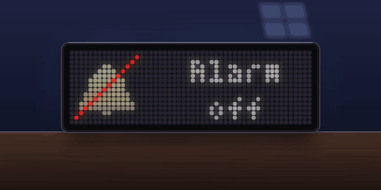
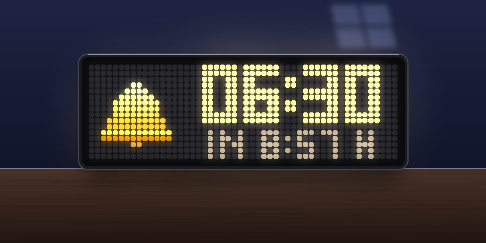
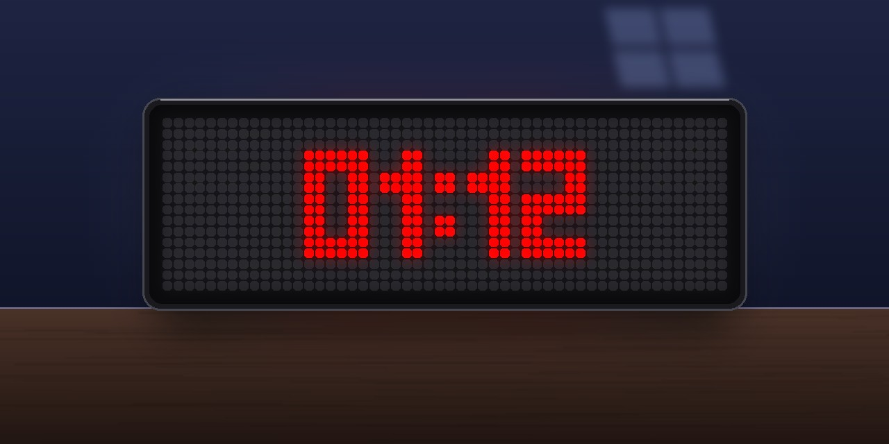
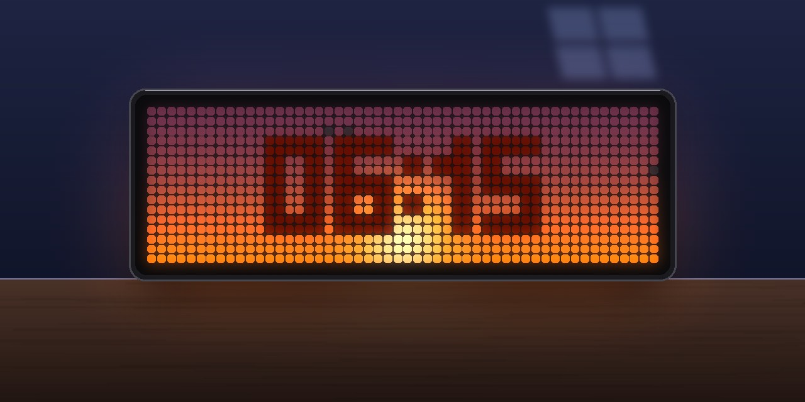
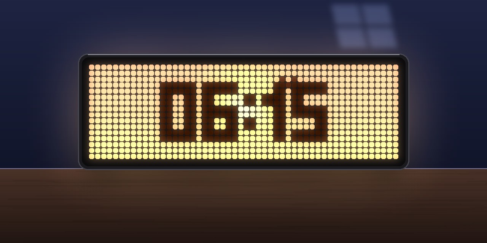
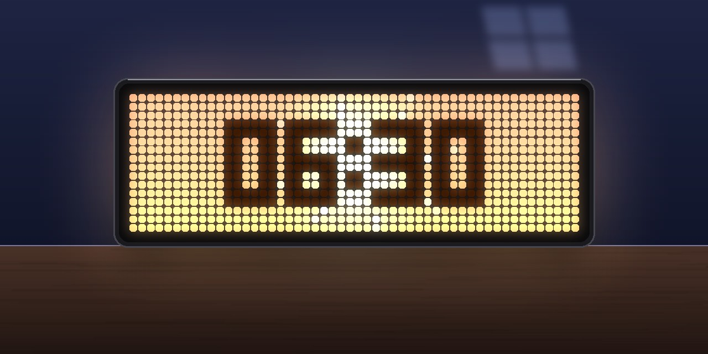
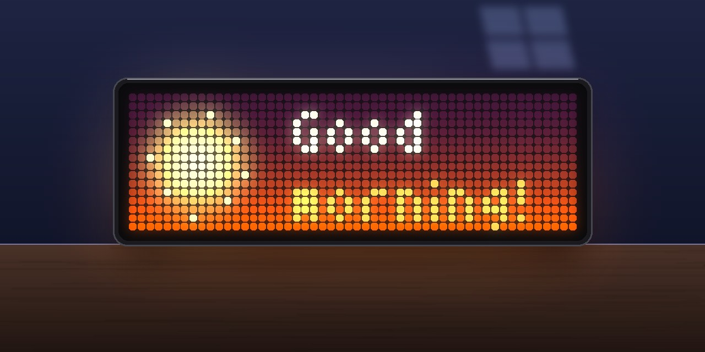

# Sunrise Alarm for AWTRIX NG (Ulanzi TC002)

**Version 1.6** · by Hank_the_Tank / Claude · for the **52×16 panel** of the Ulanzi TC002



**Install from the AWTRIX Hub:** [https://awtrix.de/script/xtRmQ4UuyR5r](https://awtrix.de/script/xtRmQ4UuyR5r)

> **Inspired by Blueforcer's [Super Alarm Clock](https://awtrix.de/script/ybNQ4zV5qxfS).** His Mario alarm clock for kids gave me the idea, and its alarm logic (two schedules, sunrise, snooze, restoring the brightness) was the starting point. Many thanks, Blueforcer! Sunrise Alarm is the grown-up version: no characters, no music from games, just calm light and a clock you can read in the dark.

A **wake-up light** for your bedside table. While an alarm is set, the panel shows **only the time in red** at night. Before the alarm it turns into a **sunrise**: the sky slowly changes from deep red through orange to warm white, the sun comes up and the panel dims up its brightness. Then soft bells ring and get louder step by step. After you get up, a short "Good morning!" greets you, and the clock goes back to normal.

```
 night            sunrise                    alarm               after the alarm
┌────────────┐   ┌────────────┐            ┌────────────┐       ┌──────────────┐
│            │   │ ░░░░░░░░░░ │            │ ▒▒▒ \|/ ▒▒ │       │  ☀    Good   │
│   23:41    │ → │ ▒ 06:15 ▒▒ │  →  ... →  │ ▒ 06:30 ▒▒ │   →   │     morning! │
│  (red)     │   │ ▓▓▓▓☀▓▓▓▓▓ │            │ ▒▒▒ /|\ ▒▒ │       │              │
└────────────┘   └────────────┘            └────────────┘       └──────────────┘
```

## Features

- **Two alarm times**, each for Mon–Fri, Sat–Sun or every day. A master switch turns both off when you are on holiday.
- **Red night display.** While an alarm is set for the coming night, the clock takes over the panel from a chosen time (default 22:00): only the time in big red block digits with a leading zero (`01:00`), centred, with a steady colon that does not blink. Other apps stay out of the way. The brightness can drop to a low level for the night. Left and right show the other apps, and the red clock comes back after two minutes. **Awake early?** Press the middle button or the knob to end the night display for the rest of the night: the brightness goes back to normal, a quiet "Good morning!" appears and the clock returns to the rotation. An alarm that is still set rings anyway, with its sunrise.
- **Dark at night (optional).** Switch on *Hide the clock at night* and the panel stays completely dark during the night display. Press any button or the knob and the red time appears for a few seconds (default 10), then fades out again. While the time is visible, the buttons work as usual.
- **Night display without an alarm (optional).** Switch on *Also without an alarm* and the red clock appears every night, from the start time until an end time you choose (default 06:30). On nights with an alarm, the alarm decides as before.
- **Silent wake-up light.** On those nights without an alarm, the night display can end with a silent sunrise: the sky slowly gets lighter during the last minutes, without birdsong or bells. At the end time a quiet "Good morning!" appears, and the clock goes back to the rotation. Press the right button to end it early.
- **Sunrise.** Starting a set time before the alarm (default 15 minutes), the panel turns into a sky that slowly gets lighter. A sun rises from the bottom edge with a soft glow, and later two birds fly by. The panel dims up step by step to a brightness you choose. Soft birdsong plays in the last third, which you can switch off.
- **Gentle alarm.** Bells with a soft pad, starting quietly and getting louder every 45 seconds. Or classic beeps, if you prefer. The sun pulses to the beat of the music. All sounds come from the TC002's built-in synthesizer, so you don't need to install any MP3s.
- **Snooze.** Press the left or middle button, or press the knob. A calm amber countdown shows the time left. You choose how often snoozing is allowed. After that, the snooze button ends the alarm.
- **Good morning.** Press the right button, or press and hold the knob, to stop the alarm. A sun with rotating rays and "Good morning!" appear with a short chime. Then the clock returns to its previous brightness and goes back to the rotation.
- **Up before the alarm?** Press the right button during the sunrise and the alarm is off for today.
- **Day view.** In the rotation, the app shows a golden bell that swings in, with the next alarm time and how long until then (`IN 8:10 H`, or `ON SAT` for later days). A crossed-out bell means the alarm is off. You can hide the app from the rotation completely. It then only appears at night and for the alarm.
- **Try it out.** Press the middle button in the day view to start a 20-second preview: sunrise, then the alarm. Stop it with the right button.
- **Safe.** The app restores the brightness and the auto-brightness setting it changed, even after a restart in the middle of an alarm. If the panel was switched off, the sunrise switches it on and turns it off again afterwards. If nobody gets up, the ringing stops after a set time (default 15 minutes).

## Requirements

- An **Ulanzi TC002** running **AWTRIX NG**, **firmware 1.1.7 or newer** (tested on 1.2.0). The bells, the birdsong and the chime use the TC002's built-in synthesizer, and the knob controls need 1.1.7.
- A **52×16** display. The layout is written for it and is not meant for 32×8 clocks.
- No icons or sound files are needed. The bell, sun, sky and digits are drawn in code, and all sounds are synthesized.
- An internet connection only for the correct time. The app makes no web requests.

## Installation

### The easy way (recommended): Send to AWTRIX

1. Open [Sunrise Alarm on the AWTRIX Hub](https://awtrix.de/script/xtRmQ4UuyR5r), press **Send to AWTRIX** and choose your TC002 in the next step.
2. Done – the app is installed and joins the rotation right away.

### Then: set your alarm

Open the AWTRIX web interface (the clock's IP address or `http://awtrixng-xxxxxx.local`), go to the **Apps** tab, click the **gear** on the *SunriseAlarm* row, set your alarm times and switch on **Alarm on**. The alarm is **off** after installing, so it never rings by surprise.

### Updates

New versions are announced on the clock itself – once your Hub account is connected:

1. In the AWTRIX web interface open **System → AWTRIX Hub** and enter your **Hub connection key**. You find it in your Hub account settings (**Open Hub account**).
2. Go to the **Scripts** tab and press **Check for updates**. Scripts with a newer version on the Hub are marked there.

### Manual installation

Only if you can't use the button:

1. Open the AWTRIX web interface and go to the **Scripts** tab.
2. Create a new script called **`SunriseAlarm`**, paste the contents of [`SunriseAlarm.ax`](SunriseAlarm.ax) and press **Save**.
3. Set your alarm as described above.

If the panel shows a red **`ERR:`**, the error message is shown next to the script in the Scripts tab. Please include it in your feedback.

## Controls

| When | Left / middle button | Right button | Knob |
|---|---|---|---|
| Day view | middle: 20 s preview | next app | brightness / volume as usual |
| Night display, clock hidden | any button: show the time | any button: show the time | press: show the time |
| Night display | middle: end the night display · left: previous app (2 min) | next app (2 min) | press: end the night display |
| Sunrise | – | alarm off for today | hold: alarm off for today |
| Ringing | snooze | stop, "Good morning!" | press: snooze · hold: stop |
| Snoozing | middle: ring now | stop | hold: stop |

Turning the knob always changes the volume, so you can turn the alarm down while it rings.

## Settings

All settings are on the **Apps** tab, behind the gear on the *SunriseAlarm* row, sorted into groups. Saving restarts the app.

| Group | Setting | Default | What it does |
|---|---|---|---|
| Alarm times | **Alarm on** | off | Master switch for both alarms |
| | **Alarm time 1 / 2** | 06:30 / 08:30 | 24-hour time, e.g. `06:45` or `7:30` |
| | **Days for alarm 1 / 2** | Mon-Fri / Off | Mon-Fri, Sat-Sun, Daily or Off |
| Night | **Red night display** | on | Only the time in red at night (master switch for the night display) |
| | **Night display from** | 22:00 | When the night display starts. With an alarm it ends with the sunrise before it. |
| | **Also without an alarm** | off | Night display every night, also when no alarm is set for the morning |
| | **Night display until** | 06:30 | End of the night display on nights without an alarm |
| | **Night display colour** | red | Colour of the night digits |
| | **Brightness at night** | 4 % | Panel brightness during the night display. `0` leaves it alone. |
| | **Hide the clock at night** | off | The panel stays dark at night; a button press shows the time |
| | **Show the time for** | 10 s | How long the time stays visible after a press (1–120 s) |
| Sunrise | **Sunrise before the alarm** | 15 min | Length of the sunrise (0–60 min). `0` turns it off. |
| | **Brightness at the end** | 80 % | The panel dims up to this brightness. `0` means no dimming. |
| | **Birdsong** | on | Soft chirping in the last third of the sunrise |
| | **Sunrise without an alarm** | on | Silent sunrise at the end of the night display on nights without an alarm (needs *Also without an alarm*). It uses the sunrise length and brightness above. |
| Alarm sound | **Alarm sound** | Bells | `Bells`: soft bells with a pad. `Classic`: beep-beep. |
| | **Volume** | 60 % | Volume of the alarm. The clock's app volume applies on top. |
| | **Get louder gently** | on | Starts at 30 %, then 60 % and 100 % of the volume, every 45 s |
| Snooze | **Snooze time** | 9 min | How long one snooze lasts |
| | **Snoozes allowed** | 3 | Then the snooze button ends the alarm |
| | **Stop ringing after** | 15 min | Ends the alarm if nobody gets up |
| Display | **Show in app rotation** | on | Shows the next alarm during the day. Off: only at night and for the alarm. |

## Good to know

- **The clock must be on and in the rotation.** Like every AWTRIX app, the alarm only runs while the app is enabled. Holding the middle button opens the clock menu, as always. That cannot be changed by an app.
- **Nights without an alarm.** By default the night display only appears before an alarm. On a night without one, for example Friday night with a Mon–Fri alarm, the clock stays as usual, unless you switch on *Also without an alarm*. If an alarm is set later than *Night display until*, the night display lasts until the sunrise before the alarm.
- **Brightness.** For the night display and the sunrise, the app turns off auto-brightness and sets the brightness itself. Afterwards it puts back exactly what was set before.
- **Missed alarms.** If the clock is restarted or loses power during the alarm minute, that alarm is missed. A sunrise that was interrupted continues after a restart.

## Gallery








## Changelog

- **1.6** – New option *Hide the clock at night*: the panel stays dark during the night display, and a press on any button or the knob shows the time for a few seconds (*Show the time for*, default 10 s). Off by default.
- **1.5** – Fix: after the night display, the sunrise or the alarm, the clock could stay on the day view of this app for up to an hour. It now moves on to the next app right away.
- **1.4** – The middle button or the knob ends the night display early. Left and right now reliably show the other apps for two minutes.
- **1.3** – Optional night display on nights without an alarm, with its own end time and an optional silent sunrise before it ends.
- **1.2** – One empty pixel row between the alarm time and the text below it in the day view.
- **1.1** – The time always has a leading zero (`01:00` instead of `1:00`) in the night display, the sunrise and while ringing.
- **1.0** – First release.

## License

[CC BY-NC 4.0](../LICENSE) – free to use, share and modify with credit to **Hank_the_Tank**, not for commercial use. The alarm logic started from Blueforcer's [Super Alarm Clock](https://awtrix.de/script/ybNQ4zV5qxfS) – credit to him as well.
